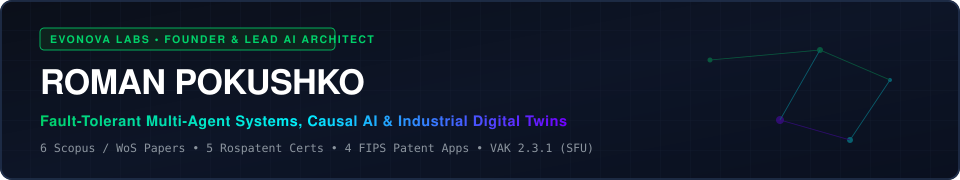

  

  
  
  
  
  

  🌐 <a href="https://pokushko.github.io"><b>EvoNova Labs Portal</b></a> &nbsp;·&nbsp;
  📬 <a href="mailto:pokusko.roman@gmail.com"><b>pokusko.roman@gmail.com</b></a> &nbsp;·&nbsp;
  🆔 <a href="https://orcid.org/0000-0003-1073-6655"><b>ORCID</b></a> &nbsp;·&nbsp;
  🟢 <b>Open to R&amp;D Grants &amp; Enterprise Consulting</b>

---

### About Me & EvoNova Labs

I am the **Founder & Lead AI Architect at EvoNova Labs** and a researcher in **System Analysis, Control, and Information Processing (VAK Specialty 2.3.1, Siberian Federal University, Krasnoyarsk)**. My work focuses on turning fragile LLM prototypes into **24/7 fault-tolerant, sandboxed, physically constrained multi-agent systems** and **industrial cybernetic digital twins**. Every architecture is backed by verifiable engineering and academic artifacts: **5 peer-reviewed Scopus / Web of Science publications**, **4 registered Rospatent software certificates**, **4 pending FIPS invention patent applications**, and **open-source Python runtimes with automated CI verification**.

---

### Open-Source Systems & Live CI

| Repository | Architecture & Production Focus | Build / Status |
| :--- | :--- | :--- |
| **[awesome-autonomous-agent-resilience](https://github.com/pokushko/awesome-autonomous-agent-resilience)** | Curated Awesome index (**160** verified frameworks, papers & post-mortems), **MAST & OWASP Agentic Top 10** [Failure Taxonomy](https://github.com/pokushko/awesome-autonomous-agent-resilience/blob/main/TAXONOMY.md), and executable [Chaos Benchmark (`F01–F10`)](https://github.com/pokushko/awesome-autonomous-agent-resilience/blob/main/benchmarks/README.md). |  |
| **[sci-integrity-guard](https://github.com/pokushko/sci-integrity-guard)** | Neuro-symbolic manuscript linter enforcing **cross-table numeric parity**, **CrossRef/OpenAlex DOI verification**, escape sanitation, and **LaTeX-to-Word OMML** compilation. |  |
| **[evonova-causal-guard](https://github.com/pokushko/evonova-causal-guard)** | Zero-dependency Python **Pearl *do*-calculus DAG verifier** (Bayes-Ball & Backdoor Criterion), **Tabu memory**, and **multi-agent debate arbiter**. |  |
| **[agent-bunker](https://github.com/pokushko/agent-bunker)** | 24/7 chaos engineering & resilience harness for autonomous agents featuring **SQLite WAL journaling**, **RSS memory ceiling guards**, and **tri-state circuit breakers**. |  |
| **[orchestration-engine](https://github.com/pokushko/orchestration-engine)** | Zero-dependency Python `asyncio` MAS orchestrator with **Kahn topological DAG waves**, configurable **timeouts/retries**, fault isolation, and **consensus reducers**. |  |
| **[agent-security-sandbox](https://github.com/pokushko/agent-security-sandbox)** | Pre-flight **Python AST security inspector**, prompt-injection sanitizer, and isolated execution runtime preventing dunder reflection escapes and secret leaks. |  |
| **[agentic-vector-memory](https://github.com/pokushko/agentic-vector-memory)** | Dual-store episodic & semantic memory engine combining **exponential temporal decay**, hybrid cosine similarity scoring, and **SQLite ACID persistence**. |  |
| **[ktk_elou_avt_core](https://github.com/pokushko/ktk_elou_avt_core)** | Industrial cybernetic digital twin prototype for crude oil atmospheric/vacuum distillation units (**ELOU-AVT**, CASE-IN Engineering Championship participant). |  |
| **[evonova-chem-core](https://github.com/pokushko/evonova-chem-core)** | Cheminformatics & RDKit molecular descriptor screening core for constraint-preserving autonomous scientific discovery. |  |

---

### Peer-Reviewed Publications & Registered IP

#### Peer-Reviewed Journal & Conference Articles (Scopus / Web of Science)

| Year | Publication Title | Venue / Indexation | DOI |
| :---: | :--- | :--- | :--- |
| 2025 | *The Charnes, Cooper and Rhodes model and its application* | *Facta Universitatis, Series: Mathematics and Informatics* (WoS Q3 / Scopus) | [`10.22190/FUMI240306015P`](https://doi.org/10.22190/FUMI240306015P) |
| 2024 | *Data Envelopment Analysis for efficient traffic management* | *ITM Web of Conferences* (WoS / Scopus) | [`10.1051/itmconf/20245901002`](https://doi.org/10.1051/itmconf/20245901002) |
| 2024 | *Sample size analysis for conducting research* | *ITM Web of Conferences* (WoS / Scopus) | [`10.1051/itmconf/20245903006`](https://doi.org/10.1051/itmconf/20245903006) |
| 2023 | *Algorithm for Application of a Basic Model for the Data Envelopment Analysis Method in Technical Systems* | *Algorithms* (Scopus / WoS Q2) | [`10.3390/a16100460`](https://doi.org/10.3390/a16100460) |
| 2023 | *Slack Based Model for Enterprises' Efficiency Improvement* | *European Proceedings of Computers and Technology* (WoS) | [`10.15405/epct.23021.43`](https://doi.org/10.15405/epct.23021.43) |

- **Zenodo Preprint (2026):** *EvoNova Scientist: A Neuro-Symbolic Multi-Agent Framework for Physical Constraint-Preserving Autonomous Scientific Discovery* (Pokushko R. V., Pokushko M. V.) — [`10.5281/zenodo.23942797`](https://doi.org/10.5281/zenodo.23942797)

<b>Registered Intellectual Property — 4 Rospatent Software Certificates &amp; 4 FIPS Patent Applications (Pending)</b>

#### Rospatent Registered Software Certificates (Свидетельства о государственной регистрации программы для ЭВМ)
1. **№ 2026695054** (Reg. 11.11.2026) — Cascading Evolution System (*«Система каскадной эволюции»*)
2. **№ 2026690237** (Reg. 02.10.2026) — Causal Analysis System (*«Система каузального анализа»*)
3. **№ 2026667533** (Reg. 09.06.2026) — AI-Based Collective Hypothesis Verification Module (*«Модуль коллективной верификации гипотез на основе искусственного интеллекта»*)
4. **№ 2025681960** (Reg. 20.08.2025) — Input Data Evaluation Software Based on Multiple Regression and Least Squares (*«Программное обеспечение оценки исходных данных на базе множественной регрессии и метода наименьших квадратов»*)

#### FIPS Invention Patent Applications (Зарегистрированные заявки на изобретения, Pending Examination)
- **Application № 2026161939** (Priority 14.11.2026, IPC `G06N 5/02`) — Intelligent System for Causal-Cognitive Filtering, Iterative Multi-Agent Verification, and Graph-Based Storage of Scientific Hypotheses (*«Интеллектуальная система каузально-когнитивной фильтрации, итерационной мультиагентной верификации и графового хранения научных гипотез»*)
- **Application № 2026161953** (Priority 15.11.2026, IPC `G06N 3/126`) — System for Adaptive Cross-Domain Evolutionary Synthesis, Multi-Criteria Pareto Selection, and Population Stagnation Prevention (*«Система адаптивного междоменного эволюционного синтеза, многокритериальной Парето-селекции и предотвращения популяционной стагнации»*)
- **Application № 2026161956** (Priority 15.11.2026, IPC `G16C 20/10`) — Hardware-Software Complex for Generating Physicochemical Synthesis Passports, Structural Novelty Control, and Cascading Compute Dispatch (*«Программно-аппаратный комплекс генерации физико-химических паспортов синтеза, контроля структурной новизны и каскадной диспетчеризации вычислительных ресурсов»*)
- **Application № 2026161957** (Priority 15.11.2026, IPC `G06F 9/455`) — Computing System for Batch Tensor Compilation of Symbolic Hypotheses, Minimax Stress Verification, and Self-Expansion of the Elementary Operator Basis (*«Вычислительная система пакетной тензорной компиляции символьных гипотез, минимаксной стресс-верификации и саморасширения базиса элементарных операторов»*)

---

### Enterprise Consulting & R&D Grants

| Engagement Track | What We Deliver | Target Audience |
| :--- | :--- | :--- |
| **1. AI Agent Production Hardening & Chaos Audit** | Failure-mode audit against **MAST & OWASP Agentic Top 10**, SQLite/Postgres WAL state recovery, tri-state circuit breakers, pre-flight AST & microVM sandboxing, and fault-injection stress suites. | AI startups & engineering teams moving agents from prototype to 24/7 production |
| **2. Custom 24/7 Multi-Agent Systems** | End-to-end Python `asyncio` DAG orchestration, bounded episodic memory with temporal decay, **OpenTelemetry GenAI** observability, and automated CI regression pipelines. | Enterprise automation, FinTech/ops copilots & R&D automation platforms |
| **3. Industrial Digital Twins & Scientific AI** | Cybernetic process simulation (energy, petrochemical & continuous manufacturing), DEA efficiency modeling, RDKit/symbolic physical invariant enforcement. | Industrial enterprises & deep-tech R&D divisions |
| **4. Joint R&D Grants & Consortiums** | Technical architecture, mathematical modeling, IP registration, and Scopus/WoS co-authoring for **RSF (РНФ)**, **FASIE (ФСИ «Старт»)**, **Skolkovo**, and **BRICS STI** calls (VAK Specialty 2.3.1, SFU). | Universities, industrial partners & deep-tech founders |

> **[Request Enterprise Audit / Pilot](mailto:pokusko.roman@gmail.com?subject=EvoNova%20Labs%20%E2%80%94%20Enterprise%20AI%20Inquiry)** &nbsp;|&nbsp;
> **[Propose R&D Grant Collaboration](mailto:pokusko.roman@gmail.com?subject=EvoNova%20Labs%20%E2%80%94%20R%26D%20Grant%20Collaboration)** &nbsp;|&nbsp;
> **[Visit EvoNova Labs Portal](https://pokushko.github.io)**

---

### Core Engineering Stack

| Layer | Technologies |
| :--- | :--- |
| **Languages & Runtime** | Python 3.11+, C++20, SQL, Rust, Bash, PowerShell, `asyncio` |
| **Multi-Agent & Resilience** | Custom DAG Orchestrators, LangGraph, LiteLLM, SQLite WAL, Circuit Breakers, AST Sandboxing |
| **Scientific & Causal AI** | PyTorch, NumPy, SciPy, SymPy, PySR, DoWhy, Z3, RDKit, Data Envelopment Analysis (DEA) |
| **Data, Obs & DevOps** | DuckDB, SQLite, Qdrant, Parquet, OpenTelemetry, Docker, Linux VPS, GitHub Actions (`pytest`, `ruff`) |
